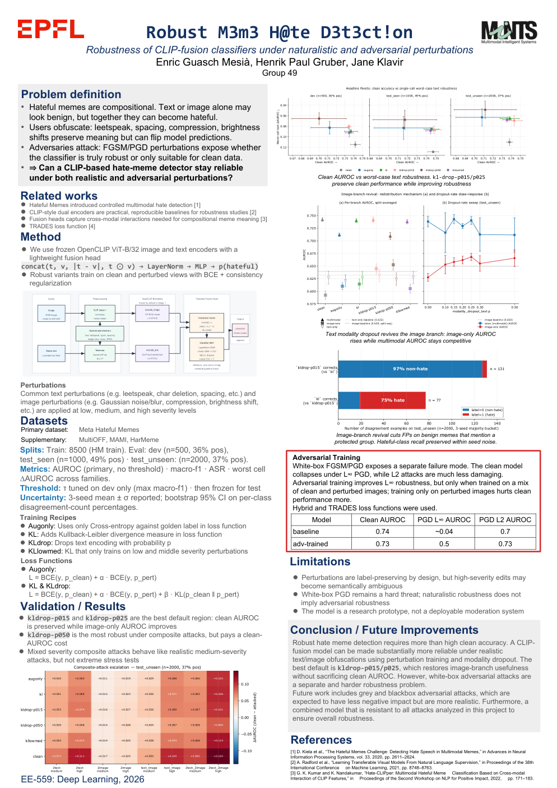
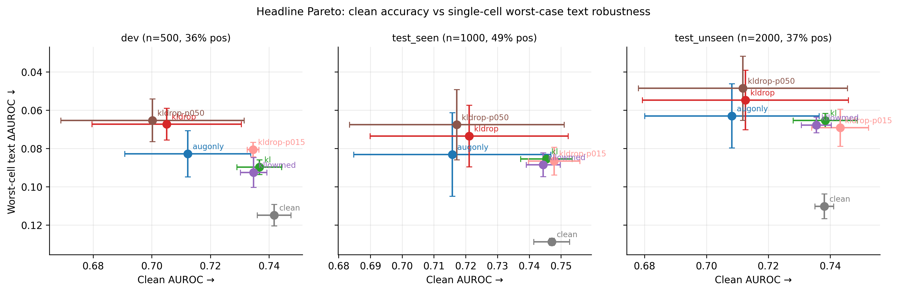
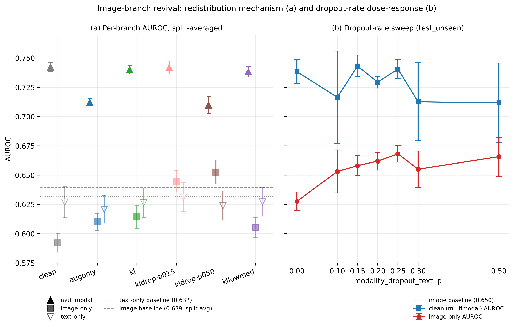
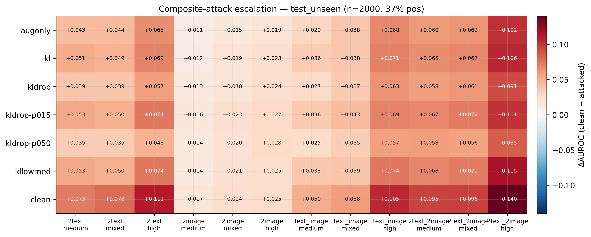
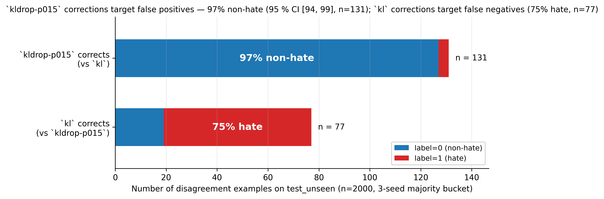

# Robust Meme Hate Detection

**How trustworthy is a hateful-meme detector once real users start editing
memes, or attackers start perturbing them, and can a cheap training recipe fix
it?** An audit and defense study of CLIP-based multimodal classifiers on the
Hateful Memes dataset. EPFL EE-559 *Deep Learning* group project (Group 49), 2026.

[](docs/poster.pdf)

**[Poster (PDF)](docs/poster.pdf)** ·
**[Short paper (PDF)](project_planning/DL_report.pdf)**

## Highlights

- **Found a hidden failure.** A strong CLIP-fusion classifier (0.73 AUROC, +0.10
  over the best single-modality model) is really a *text shortcut*: its image
  branch is nearly dead (image-only AUROC 0.59 vs 0.63 for a dedicated image
  model), so trivial text edits such as typos, leetspeak or censoring hurt it
  most. Under white-box PGD at ε = 2/255 its AUROC collapses to ≈ 0.
- **Fixed it with a two-line change to training.** Consistency regularisation
  (KL between clean and perturbed predictions) plus random *text-modality
  dropout* revives the image branch (0.59 → 0.66, above the dedicated
  baseline) at no clean-accuracy cost, and raises the number of held-out memes
  that survive all 57 naturalistic attacks from 222 to 391 of 2000 (+76 %).
- **Explained why it works.** The defense is class-asymmetric: 97 % of the
  predictions it corrects are benign memes, so the revived image branch acts as
  a false-positive veto against over-flagging edited but harmless captions.
- **Rigorous protocol.** 3 seeds × 3 splits (dev, test_seen, test_unseen),
  thresholds tuned on dev only, bootstrap confidence intervals, deterministic
  SHA-256-keyed perturbations, and honest reporting of negative results.

## Results

All numbers are 3-seed means. Figures are generated by
`scripts/make_poster_figures.py` straight from the evaluation outputs.

### 1. Clean accuracy vs. worst-case text robustness

Down-right is better (the y-axis is inverted). Every robust recipe cuts the
worst single-cell text ΔAUROC of the clean baseline (≈ 0.11-0.13) to
≈ 0.06-0.09 on all three splits. `kl` and `kldrop-p015` do so at essentially no
clean-AUROC cost, while `kldrop-p050` is the most robust but has a lower and
noisier clean AUROC.



### 2. Modality dropout revives the image branch

(a) Without dropout the image-only branch is nearly dead; with text dropout it
reaches or exceeds the dedicated image-only baseline while multimodal AUROC is
preserved. (b) On `test_unseen`, image-only AUROC rises with the dropout rate
p, and p = 0.15-0.25 keeps the multimodal AUROC at the no-dropout level
(larger p loses it). Error bars show the spread across splits (a) or seeds (b).



### 3. Composite attacks are the worst naturalistic threat

ΔAUROC on `test_unseen` when several perturbations are combined. The clean
baseline drops by up to 0.140 (`2text_2image`, high severity); robust recipes
reduce this to 0.085-0.115, with `kldrop-p050` the strongest defender.
Image-only composites are comparatively harmless.



### 4. Why it works: a class-asymmetric false-positive veto

Where `kldrop-p015` and `kl` disagree on `test_unseen`, the examples
`kldrop-p015` gets right are 97 % non-hate (95 % CI 94-99 %, n = 131). The ones
`kl` gets right are mostly hate (75 %, n = 77), so `kl` is preferable when
recall matters more than false positives. The choice is deployment-dependent.



### Summary table (held-out `test_unseen`, n = 2000)

| Recipe | Clean AUROC | Worst text-attack ΔAUROC ↓ | Image-only AUROC ↑ | Memes robust to all 57 attacks ↑ |
|---|---:|---:|---:|---:|
| clean (baseline) | 0.738 | 0.110 | 0.602 | 222 |
| `augonly` | 0.708 | 0.063 | 0.620 | 282 |
| `kl` | 0.738 | 0.065 | 0.628 | 352 |
| **`kldrop-p015`** (recommended) | **0.743** | 0.069 | 0.658 | **391** |
| `kldrop-p050` | 0.712 | **0.049** | **0.666** | 331 |

### White-box adversarial robustness

Naturalistic augmentation does not help against gradient-based attacks: every
naturalistic recipe is fully broken by PGD at ε ≥ 2/255. A separate Madry-style
adversarial-training track (PGD on the image branch with an unfrozen vision
encoder) closes that gap, but at a clear cost, which is the main open problem:

| Model (test_unseen) | Clean AUROC | AUROC under PGD, ε = 8/255 | Attack success rate |
|---|---:|---:|---:|
| naturalistic recipe (frozen encoders) | 0.713 | 0.000 | 100 % |
| adversarially trained | 0.616 | 0.610 | 0.6 % |
| adversarial + naturalistic combined | 0.614 | 0.610 | 0.3 % |

Full tables are in `project_planning/phase4/`
(`unified_cross_robustness.auroc.md`, `robust_vs_clean.test_unseen.md`,
`whitebox_table.test_unseen.md`).

### Limitations

- Perturbations are label-preserving by design, but high-severity edits may
  become semantically ambiguous.
- Even the best recipe leaves about 70 % of examples vulnerable to *some*
  perturbation in the grid; further gains likely need a stronger text encoder
  or a representation-level robustness loss rather than more augmentation.
- The dropout sweep covers p ∈ {0, 0.10, 0.15, 0.20, 0.25, 0.30, 0.50}; no
  global optimality claim outside that range.
- Research prototype, not a moderation system.

## Approach

**Model.** OpenCLIP ViT-B/32 image and text encoders (frozen) feed a small
fusion head over `[t, v, |t − v|, t ⊙ v]` (2048-d → LayerNorm → 512 → GELU →
1), 1.05 M trainable parameters. Image normalisation lives *inside* the model,
so the forward pass is differentiable with respect to raw `[0, 1]` pixels and
white-box attacks and consistency training share one graph. Zeroing either
embedding gives image-only / text-only forward modes for modality ablations.
Spec: [`project_planning/model_architecture.md`](project_planning/model_architecture.md).

**Perturbation suite.** 8 text attacks (leetspeak, character deletion/swap,
spacing, punctuation, case noise, censoring, keyboard typos) and 11 image
attacks (noise, blur, JPEG, brightness/contrast, translation, crop, occlusion,
typographic overlay), each at low / medium / high severity, plus composite
cells that stack 2-4 perturbations per sample. Every cell is seeded
deterministically. Details: [`docs/PERTURBATIONS.md`](docs/PERTURBATIONS.md).

**Robust training.** Each batch pairs a clean view with an on-the-fly perturbed
view. Recipes: `augonly` (`BCE_clean + BCE_pert`), `kl` (adds
`β·KL(p_clean ‖ p_pert)`), `kldrop` (adds per-example text-embedding dropout
with probability p), and `kllowmed` (`kl` restricted to low/medium severity).

**Evaluation.** AUROC (primary), macro-F1, FPR/FNR, attack success rate and
ΔAUROC per attack cell, worst-case-across-families, per-example failure
bucketing with bootstrap CIs, and L∞ / L2 FGSM and PGD sweeps.

**Also included.** Converters that rewrite MAMI, HarMeme and MultiOFF into the
Hateful Memes layout so every trainer and evaluator runs on them unchanged;
a Docker image and Run:AI launch scripts for the EPFL GPU cluster.

## Using the code

Requires Python 3.10+. `src/robust_meme_hate_detection/` is the package,
`configs/` holds one YAML per recipe, `scripts/` holds the aggregation and
figure scripts.

```bash
# install and sanity-check (CPU only, no dataset needed)
pip install -e . -r requirements.txt
pytest tests/
python -m robust_meme_hate_detection.tests.smoke_synthetic   # forward + backward + PGD
```

Datasets are not redistributed. Download Hateful Memes, then point
`data.dataset_root` in the config at it (layout: `train.jsonl`, `dev.jsonl`,
`test_seen.jsonl`, `test_unseen.jsonl`, `img/`). Split policy: [`docs/DATA.md`](docs/DATA.md).

```bash
export PYTHONPATH=src

# train: clean baseline, then a robust recipe (one config per recipe)
python -m robust_meme_hate_detection.train.stage1        --config configs/stage1.yaml                 --seed 0 --out runs/clean
python -m robust_meme_hate_detection.train.stage1_robust --config configs/stage1_robust_kl_drop_p015.yaml --seed 0 --out runs/kldrop-p015

# evaluate: naturalistic attack grid, and white-box FGSM/PGD sweep
python -m robust_meme_hate_detection.eval.run_perturbed --ckpt runs/kldrop-p015/ckpt/best.pt \
    --config configs/stage1_robust_kl_drop_p015.yaml --split test_unseen --out runs/kldrop-p015/perturbed
python -m robust_meme_hate_detection.eval.run_whitebox  --ckpt runs/kldrop-p015/ckpt/best.pt \
    --config configs/stage1_robust_kl_drop_p015.yaml --split test_unseen --out runs/kldrop-p015/whitebox

# adversarial / combined training (PGD, ε schedule in the config)
python -m robust_meme_hate_detection.train.stage1_robust_unified --config configs/robust_both.yaml --seed 0 --out runs/both

# aggregate results into tables and regenerate the figures
python scripts/aggregate_phase4.py
python scripts/make_poster_figures.py
```

Each run writes `metrics.json`, `ckpt/best.pt` and evaluation JSON, and seeds
Python, NumPy and PyTorch. The paper's experiments ran on the EPFL Run:AI
cluster (one A100 per job, about 140 s per training run); the cluster
launchers are `cluster/cluster.sh`, `scripts/runai_submit_template.sh`,
`scripts/run_adversarial_stage1.sh` and `scripts/run_unified_matrix.sh`, and
the `Dockerfile` builds the image with CLIP weights baked in. They need your
own Run:AI project and paths. See [`docs/CLUSTER_DATA.md`](docs/CLUSTER_DATA.md).

## Repository layout

```text
src/robust_meme_hate_detection/
  models/         CLIP fusion classifier
  data/           Hateful Memes loader, splits, MAMI/HarMeme/MultiOFF converters
  perturbations/  text and image perturbation suite, composite attacks
  attacks/        FGSM / PGD (L∞ and L2)
  train/          baseline, robust (aug / KL / modality dropout), adversarial, unified trainers
  eval/           clean, perturbation-grid, white-box and modality-ablation evaluators
configs/          one YAML per recipe
scripts/          aggregation, failure analysis, figure generation, cluster launchers
tests/            unit and smoke tests
docs/             poster, data and perturbation docs
project_planning/ paper, per-phase reports, result tables (phase4/), figures
```

Detailed per-experiment write-ups (kept as lab notes) are in
`project_planning/Phase*_Report.md`.

## Authors

Enric Guasch Mesià, Henrik Paul Gruber, Jane Klavir. EE-559 *Deep Learning*, EPFL, 2026.
